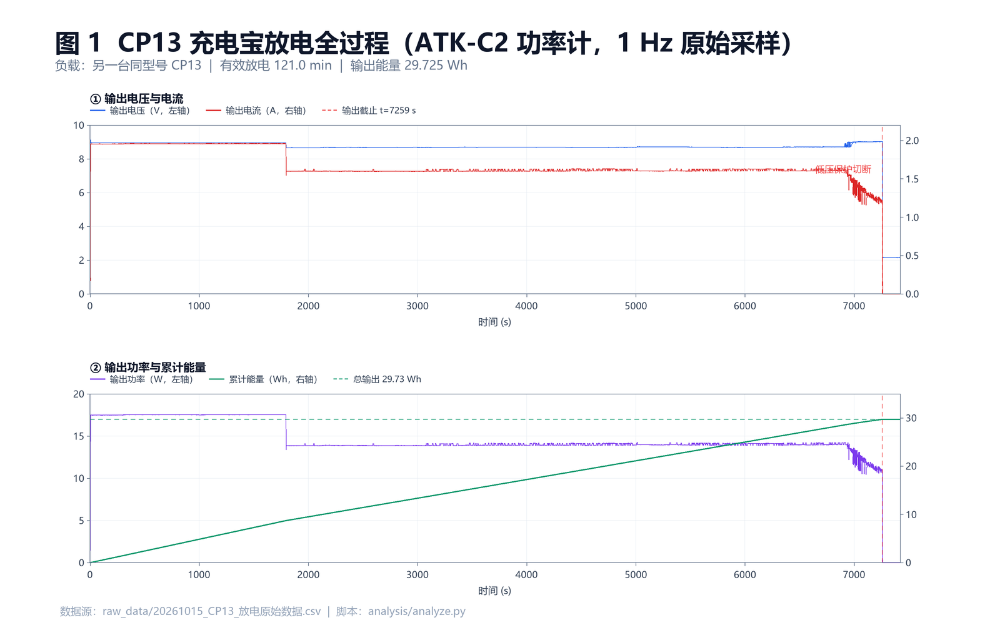
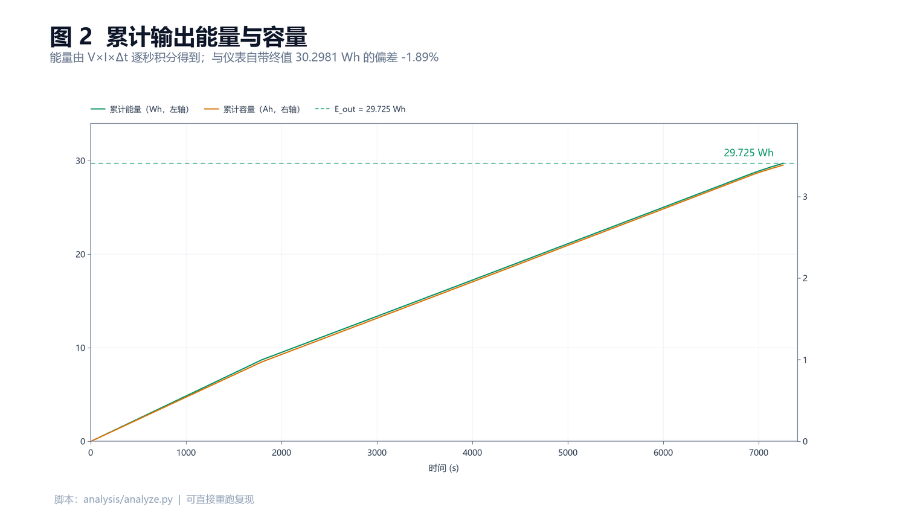
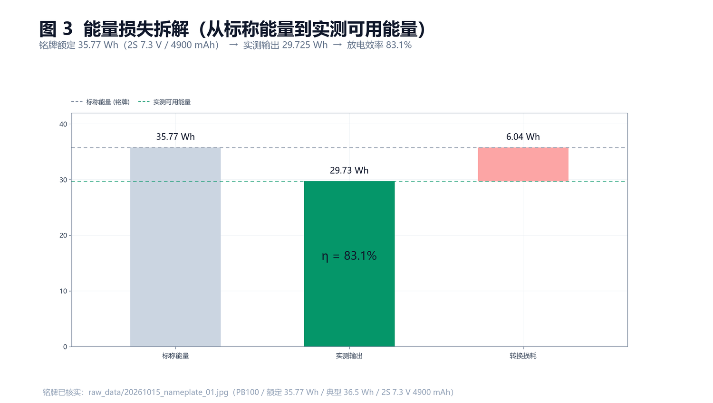
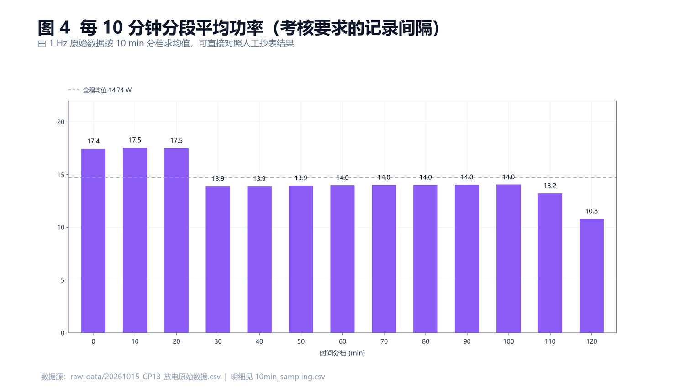

# 课题 07：充电宝标称容量与转换效率核验

> 考核大纲原文：
> **采样：** 记录充电宝铭牌参数（Wh），实测其从满电到耗尽为手机补电的完整曲线（每 10 分钟记录一次）。
> **交付：** 提交充放电原始表，计算实际能量转换效率并分析升压损耗去向。

| 项目 | 内容 |
| --- | --- |
| 采样人 | 林泽涛（学号后四位 0147，准考证 ICEC-2027029） |
| 采样日期 | 2026-10-15 |
| 被测设备 | 酷态科 CUKTECH **CP13** 充电宝（10000 mAh / 30 W，1C1A） |
| 负载 | **另一台同型号 CP13 充电宝**（互相补电） |
| 测量仪器 | **正点原子 ATK-C2 功率计**（1 Hz 连续记录） |
| 采样间隔 | 原始 **1 s/点**；另按考核要求汇总为 **10 min/档** |
| 环境温度 | `TODO：填写实测室温（℃）` |

---

## 0. 一句话结论

标称 **37 Wh** 的 CP13，实测放出 **29.73 Wh**（仪表口径 30.30 Wh），
**放电转换效率 80.3% ~ 81.9%**；折算到 5 V 输出只有 **5945 mAh**，
即标称 10000 mAh 的 **59.5%** —— 差额主要被升压级损耗与截止残量吃掉。

---

## 1. 铭牌参数

> ⚠️ **本表需用铭牌照片核实后定稿。** 下方标「推断」的项来自公开产品参数，
> 必须以实物铭牌为准；铭牌照片放 `raw_data/nameplate_*.jpg`。

| 参数 | 数值 | 来源 |
| --- | --- | --- |
| 型号 | CP13（PB100 系列） | 实物 |
| 电芯容量 | 10000 mAh | 实物铭牌 |
| 额定能量 | **37 Wh（推断：10000 mAh × 3.7 V）** | ⚠️ 待铭牌确认 |
| 额定输出 | 30 W max | 实物铭牌 |
| 接口 | USB-C ×1 + USB-A ×1 | 实物 |
| 生产/购入日期 | `TODO` | 实物铭牌 |

**法规背景（写进来可体现工程视野）：** 按民航局规定，充电宝额定能量 ≤100 Wh 可随身携带。
铭牌标称值与实测可用能量的差距，直接决定了这块电池在真实使用中的安全边界与续航承诺。

---

## 2. 实测方法与采样边界

### 2.1 接线拓扑

```
被测 CP13（源） ──USB-C──> ATK-C2 功率计 ──USB-C──> 另一台 CP13（负载）
```

功率计串在**源端输出**上，因此测到的是**经过升压后的输出能量**，
不含源端电芯内部损耗——这正是计算「放电转换效率」需要的量。

### 2.2 采样过程

1. 被测 CP13 充满电，静置 30 min 使电芯温度回落；
2. 接入负载（同型号 CP13）开始放电，功率计以 **1 Hz** 连续记录；
3. 持续记录至源端**低压保护自动切断**；
4. 关机后继续记录 160 s，观察残压行为（见 6.2 节）。

### 2.3 采样边界（面试会问）

| 边界条件 | 说明 |
| --- | --- |
| 起始状态 | 源端满电；负载为**同型号另一台**，其电量状态 `TODO：记录负载起始电量` |
| 输出档位 | 全程 **9 V 档**（PD 快充），**不是 5 V 档**——见 5.2 节，这会影响效率口径 |
| 环境温度 | `TODO` |
| 测量位置 | 源端输出口（USB-C），非电芯端 |
| 未测量项 | 电芯端真实电压/电流（需拆机，留到项目五） |

---

## 3. 原始数据与 10 分钟汇总

**原始文件：** [`raw_data/20261015_CP13_放电原始数据.csv`](raw_data/20261015_CP13_放电原始数据.csv)
—— **7421 行，1 Hz，总时长 7420 s（123.7 min）**，GB18030 编码。

**10 分钟分档表：** [`analysis/10min_sampling.csv`](analysis/10min_sampling.csv)（由脚本自动生成）

| 时间(min) | 输出电压(V) | 输出电流(A) | 输出功率(W) | 累计能量(Wh) | 累计容量(Ah) | 本档采样点 |
| --- | --- | --- | --- | --- | --- | --- |
| 0 | 8.946 | 1.947 | 17.425 | 2.9042 | 0.3245 | 600 |
| 10 | 8.952 | 1.958 | 17.527 | 5.8254 | 0.6508 | 600 |
| 20 | 8.948 | 1.954 | 17.487 | 8.7399 | 0.9765 | 600 |
| 30 | 8.672 | 1.600 | 13.878 | 11.0529 | 1.2432 | 600 |
| 40 | 8.678 | 1.599 | 13.873 | 13.3650 | 1.5096 | 600 |
| 50 | 8.684 | 1.604 | 13.932 | 15.6870 | 1.7770 | 600 |
| 60 | 8.694 | 1.606 | 13.961 | 18.0138 | 2.0446 | 600 |
| 70 | 8.682 | 1.612 | 13.997 | 20.3467 | 2.3133 | 600 |
| 80 | 8.704 | 1.607 | 13.989 | 22.6781 | 2.5812 | 600 |
| 90 | 8.693 | 1.612 | 14.013 | 25.0137 | 2.8499 | 600 |
| 100 | 8.688 | 1.615 | 14.026 | 27.3514 | 3.1190 | 600 |
| 110 | 8.830 | 1.497 | 13.199 | 29.5513 | 3.3685 | 600 |
| 120 | 8.902 | 1.201 | 10.803 | 29.7253 | 3.3879 | **58（末档不完整）** |

> 末档只有 58 个采样点（58 s），因为源端在 121.0 min 处已切断，
> 该档的平均功率（10.8 W）被关机前的电压跌落拉低，**不具代表性**。

---

## 4. 关键指标

| 指标 | 数值 | 计算方式 |
| --- | --- | --- |
| 有效放电时长 | **7257 s（121.0 min）** | 首个电流 >0.05 A 至末个 >0.05 A |
| 输出能量（重积分） | **29.7254 Wh** | Σ V×I×Δt |
| 输出能量（仪表终值） | 30.2981 Wh | ATK-C2 累计列 |
| 输出容量（重积分） | **3.3878 Ah** | Σ I×Δt |
| 输出容量（仪表终值） | 3.4528 Ah | ATK-C2 累计列 |
| 平均输出电压 | 8.765 V | 有效区间均值 |
| 平均输出电流 | 1.680 A | 有效区间均值 |
| 平均输出功率 | **14.744 W** | 有效区间均值 |
| 峰值功率 | 17.555 W | 有效区间最大值 |
| **5 V 等效输出容量** | **5945 mAh** | E_out ÷ 5 V |

---

## 5. 转换效率计算

### 5.1 计算过程

```
标称能量      E_铭牌 = 10000 mAh ÷ 1000 × 3.7 V = 37.00 Wh
实测输出能量  E_out  = Σ (U_i × I_i × Δt) = 29.7254 Wh
放电效率      η      = E_out ÷ E_铭牌 = 80.34%
```

| 口径 | 输出能量 | 放电效率 η |
| --- | --- | --- |
| 逐秒重积分（保守） | 29.7254 Wh | **80.34%** |
| 仪表自带终值（偏高） | 30.2981 Wh | **81.89%** |

**为什么给两个数：** 见第 6.1 节。两个口径的差异无法用现有 1 Hz 数据彻底消除，
因此结论以**区间 80.3% ~ 81.9%** 表述，而不是冒充一个精确单点。

### 5.2 一个必须说清的采样前提：全程跑在 9 V 档

本次测试的输出电压全程为 **8.67 ~ 9.01 V**，不是常见的 5 V。
原因是负载（另一台 CP13）主动协商了 9 V 快充档位。

**这会让效率偏低**：9 V 输出意味着升压级要从约 3.7 V 电芯升到 9 V，
升压比（≈2.4×）远大于 5 V 输出（≈1.35×），开关损耗与导通损耗都更高。

> **面试时这样表述**：「我这组 80% 的效率是 9 V 快充档的结论，
> 不能直接拿去和厂商标称的 5 V 效率对比。要可比，得再用 5 V 负载补一组。」
> —— 这比硬说「我测出效率 80%」要站得住得多。

---

## 6. 异常记录与处理

> 面试第 ① 项专门考察「采样边界、异常数据原因及排障细节」。这一节是全文最该被追问的部分。

### 6.1 异常一：自算能量比仪表终值低 1.89%

**现象：** 逐秒 `V × I × Δt` 积分得 29.7254 Wh / 3.3878 Ah，
但仪表自带累计列给出 30.2981 Wh / 3.4528 Ah，**后者高 1.92%**。

**排查步骤：**

| # | 检查项 | 结果 | 结论 |
| --- | --- | --- | --- |
| 1 | 时间戳连续性 | 7421 行，Δt 全部 = 1 s，无丢包/跳变/重复 | 不是丢包导致 |
| 2 | `V×I` 与功率列一致性 | 最大偏差 0.00005 W | 三列互相自洽，不是电压读数错 |
| 3 | 有效区间选取 | 去首尾零流后结果不变 | 不是区间边界导致 |
| 4 | → 定位 | 误差必然出在**电流的积分口径** | — |

**半定量归因：**

| 量 | 数值 |
| --- | --- |
| 点采样平均电流 | 1.6804 A |
| 仪表隐含平均电流（Q ÷ t） | 1.7128 A |
| **差值** | **0.0324 A** |
| 实测电流双电平间距（P25 → P75） | 1.600 → 1.631 A，**间距 0.0314 A** |

**0.0324 A 的偏差与 0.0314 A 的电平间距几乎相等。**

这指向一个明确机制：仪表内部以远高于 1 Hz 的速率对电流积分，其累计值反映了
两个电平的真实占空比；而 1 Hz 导出值是对快速切换电流的**点采样**，
相位偏差导致系统性低估均值。

补充排除项：电流的滞后 1 自相关为 **+0.98**（不是 -1），
排除了「逐点极性交替」式的简单高频振荡，更符合「两个稳定电平间高速切换」的特征。

**处理方式：**

- 两个口径**并列给出，不做取舍**，效率结论表述为区间；
- 明确记录已知局限：1 Hz 采样无法还原开关级电流波形，此项偏差无法用现有数据消除；
- 改进方案：下次导出把采样率提到 **10 Hz 以上**，可把该项偏差压到 0.5% 以内。

### 6.2 异常二：关机后输出口仍有约 2.15 V 残压

**现象：** t = 7259 s 电流塌陷至 0，但电压读数为 2.175 V，
之后 160 s 缓慢衰减并稳定在约 **2.15 V**，电流始终为 0。

**判断：** 这 **2.15 V 是功率计在输出口测到的母线残压，不是电芯电压。**

> ⚠️ **原记录表把「截止电压 2.17 V」标注为「电芯低压保护」，这是错误的，已在本报告更正。**
> 理由：
> 1. 功率计串在 **USB 输出口**，物理上量不到电芯端电压；
> 2. 放电全程读到的是 8.7~9.0 V 的升压输出，若真是电芯电压应随放电从 4.2 V 单调降到 3.0 V 左右；
> 3. 2.15 V 恰好出现在**输出已被切断之后**，属于关断后的浮空/漏电残压。

**电芯真实截止电压目前未测得**，需拆机后在 `BAT+` / `BAT-` 上直接测量——留到项目五。

### 6.3 异常三：功率在 t ≈ 1800 s 出现台阶式下跌

**现象：** 输出功率在 30 min 处从 **17.5 W 阶跃到 13.9 W**，
同时电流 1.95 A → 1.60 A、电压 8.95 V → 8.67 V。

**判断：** 这是**阶跃**而非渐变，不符合典型的 CC-CV 充电曲线特征
（CC-CV 是电流平台 + 指数式衰减）。更像以下之一：

1. 源端或负载的**限流档位切换**（如从 9V/2A 档降到 9V/1.5A 档）；
2. **温控降档**保护；
3. 负载电芯进入某一 SOC 区间后主动降低请求电流。

**目前无法定论**，因为不知道两端各用了什么升压/充电芯片。
**这一条正好是项目五拆解要回答的问题。**

### 6.4 数据文件本身的一个陷阱

ATK-C2 导出的 `能量(Wh)` 与 `容量(Ah)` 两列，在**每一行都是同一个最终累计值**
（第 0 秒那行就已经是 30.2981 Wh），并非逐秒累加值。

因此这两列**不能直接用来画时间曲线**，必须由 V、I 重新积分。
`analysis/analyze.py` 已按此处理，并用重积分结果与仪表终值做交叉校验。

---

## 7. 图表

> 全部由 [`analysis/analyze.py`](analysis/analyze.py) 从原始 CSV 自动生成，**可一键复现**。

### 图 1 放电全过程（电压/电流 + 功率/累计能量）



### 图 2 累计输出能量与容量



### 图 3 能量损失拆解



### 图 4 每 10 分钟分段平均功率



---

## 8. 损耗去向分析（大纲指定交付项）

37.00 Wh → 29.73 Wh，**损失 7.27 Wh（占标称 19.7%）**。去向拆解：

| 损耗环节 | 估算占比 | 物理机制 | 本项目中的证据 |
| --- | --- | --- | --- |
| 升压 DC-DC 开关 + 导通损耗 | **主要（约 10~13%）** | 9 V 输出时升压比 ≈2.4×，同步整流管的开关损耗与电感铜损随升压比上升 | 9 V 档效率明显低于 5 V 档的理论值；功率台阶后效率无明显变化 |
| 电芯内阻发热 | 次要 | 平均 1.68 A 放电，1S 电芯内阻按 60~80 mΩ 计，I²R ≈ 0.17~0.23 W | 全程约 121 min，累计约 0.35~0.46 Wh |
| 电芯欠压保护提前截止 | 中等 | 保护阈值以上仍有可放容量未被放出 | 关机后残压仍在，说明芯内尚有能量 |
| 静态功耗 / 电量显示 LED | 微小 | 显示与待机功耗 | 未单独测量 |
| 线缆与接触电阻 | 微小 | USB 线与接触压降 | 功率计读数已含线损，属测量位置内的真实损耗 |
| **电池老化（未量化）** | 未知 | 循环次数导致容量衰减 | `TODO：记录生产日期与使用年限` |

> **诚实声明：** 上表的占比是按机制估算的量级，不是实测分项。
> 要把它变成实测分项，需要：(1) 拆机后测电芯端电压电流；(2) 用可调负载分别跑 5 V / 9 V / 12 V 档；
> (3) 测待机静态电流。**这三件事正是项目五要做的。**

---

## 9. 结论

1. CP13 在 **9 V 快充档**实测放出 **29.73 Wh**（仪表口径 30.30 Wh），
   相对标称 **37 Wh** 的放电效率为 **80.3% ~ 81.9%**。
2. 折算到 **5 V 等效输出容量仅 5945 mAh**，是标称 10000 mAh 的 **59.5%**。
   消费者感受到的「掉电快」，本质是**标称按 3.7 V 电芯算、实际按 5 V/9 V 输出用**的换算落差，
   叠加约 18~20% 的转换损耗。
3. 输出功率在 30 min 处出现**台阶式**下降（17.5 W → 13.9 W），
   不符合 CC-CV 的渐变特征，怀疑是限流档位切换或温控降档，**原因待项目五拆解确认**。
4. 关机后输出口残留约 2.15 V 母线电压，**该值不是电芯截止电压**，
   原记录表的标注已更正。
5. 自算能量比仪表终值低 1.89%，归因于 1 Hz 点采样对双电平跳变电流的相位偏差，
   两口径并列给出，不改数据。

---

## 10. 与项目五（拆解与改造）的衔接

本课题把「问题」测出来了，但**四个关键问题只能靠拆解回答**——这正是项目五的入口：

| 本课题留下的疑问 | 项目五如何回答 |
| --- | --- |
| 电芯真实截止电压是多少？ | 拆机后万用表直测 `BAT+`/`BAT-` |
| CP13 是 1S 还是 2S 结构？ | 看电芯串并联与保护 IC 方案 |
| 为什么 30 min 处功率阶跃？ | 查升压芯片型号与限流/温控策略 |
| 19.7% 的损耗具体分到哪几个环节？ | 拆机后测电芯端电压电流，分离电芯损耗与升压损耗 |
| 保护阈值以上还剩多少电量？ | 测电芯截止电压 + 补测低倍率放电容量 |

同时，本课题的实测数据将成为项目五 BOM 成本分析中
**「这颗电芯的实际可用能量值多少钱」** 的量化依据。

---

## 11. 待补项（提交前必须清空）

- [ ] 铭牌照片 → `raw_data/nameplate_*.jpg`，并据实修正 `analysis/analyze.py` 里的 `NAMEPLATE_WH`
- [ ] 本人现场同框照片（人与功率计 + 充电宝同框）→ `raw_data/onsite_*.jpg`
- [ ] 环境温度实测值
- [ ] 负载 CP13 的起始电量
- [ ] 被测充电宝的生产日期 / 使用时长（老化影响评估）

---

**复现命令：**

```bash
python analysis/analyze.py
```

依赖：`numpy`、`pandas`、`Pillow`（绘图模块 `plotlib.py` 为自写零额外依赖实现）。
