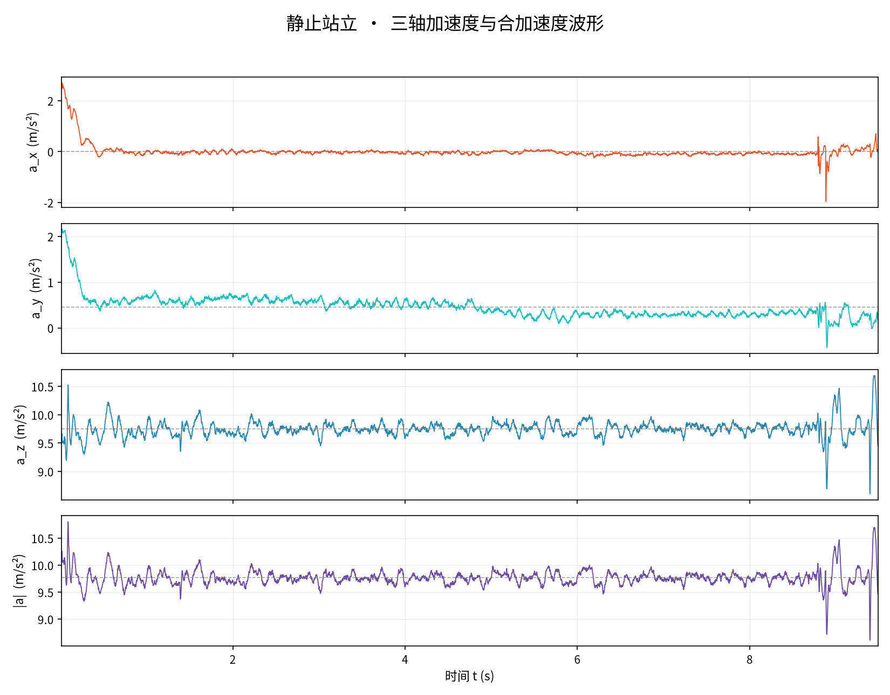
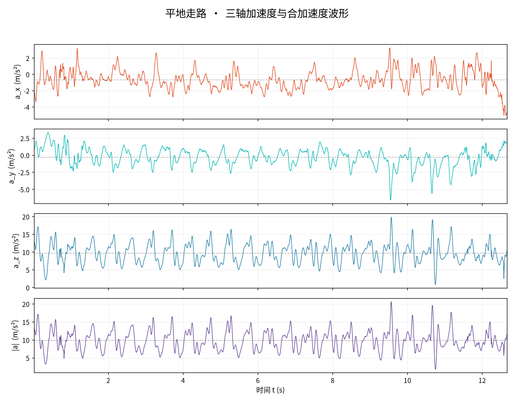
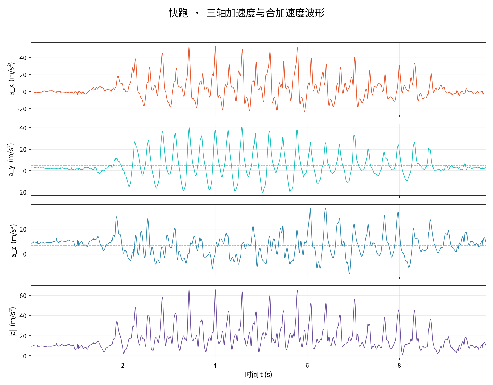
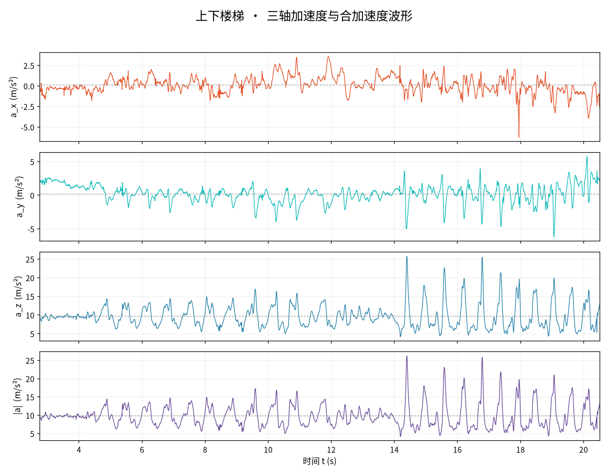
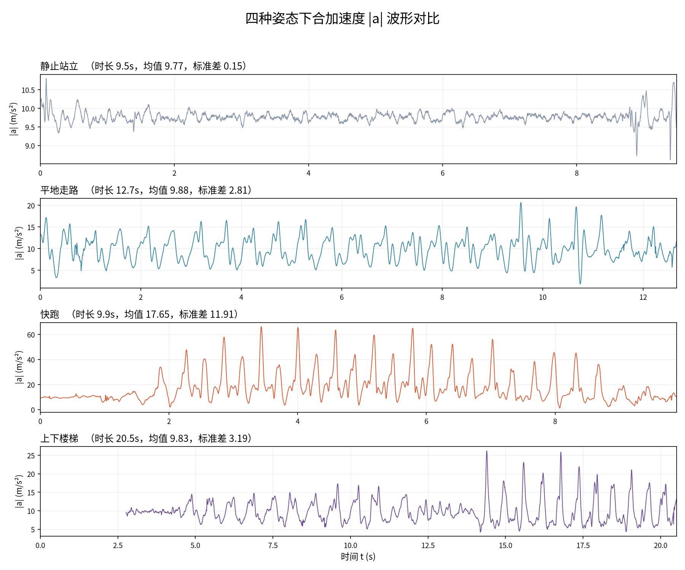

# 课题 08：多姿态步态加速度特征采集与对比

> **大纲要求**——采样：用手机传感器工具（如 Phyphox）采集平地慢走、快跑、上下楼梯、静止
> 4 种状态的三轴加速度数据；交付：4 份原始 CSV 波形文件与可视化图，提炼区分动作的阈值规则。

| 项目 | 内容 |
| --- | --- |
| 采样人 | 林泽涛（学号后四位 0147 / 准考证 ICEC-2027029） |
| 采集设备 | **OPPO PKB110** 手机内置 MEMS 三轴加速度计 |
| 采集软件 | **phyphox 1.2.1**（实验包「加速度（含 g）」） |
| 采样率 | 约 **405 Hz**（相邻点间隔 2.4~2.5 ms，非严格等间隔） |
| 采集日期 | 2026-11-23 |
| 数据格式 | xlsx 导出，每文件 5 列：时间、a_x、a_y、a_z、合加速度 |

---

## 0. 结论

四种姿态的可分性**并不均等**：

| 状态对 | 能否单阈值区分 | 靠什么特征 |
| --- | --- | --- |
| 静止 vs 其余 | ✅ 可以 | `\|a\|` 标准差（0.15 vs 2.85~12.20，差一个数量级） |
| 快跑 vs 其余 | ✅ 可以 | `\|a\|` 峰值（66.26 vs ≤26.23） |
| **平地行走 vs 上下楼梯** | ❌ **不能** | 均值都在 9.8 左右，标准差差不到 15%，必须靠**主频 + 垂直轴冲击** |

**最终判定规则在 78 个 2 秒窗口上的总体正确率 96.2%**，3 个误判全部集中在上下楼梯的
「上楼转下楼」过渡段。

---

## 1. 实验目的

用手机内置三轴加速度传感器，采集**静止站立、平地行走、快跑、上下楼梯**四种姿态的加速度序列，
提取能反映动作差异的统计特征，建立一套可执行的姿态判定规则，并检验该规则在真实连续数据上的稳定性，
为步态识别、运动监测与跌倒检测提供实测依据。

---

## 2. 实验原理

### 2.1 加速度计输出的是「比力」，不是纯运动加速度

手机加速度计输出的比力 = 运动加速度 + 重力。因此**手机静止时合加速度并不为零**，
而是稳定在重力加速度附近。

phyphox 的「加速度（含 g）」实验直接记录原始读数、**不做重力分离**，这与「线性加速度」模式不同。
**这一点决定了静止判据必须以约 9.8 m/s² 为基线，而不是以零为基线。**

合加速度：

```
|a| = √(a_x² + a_y² + a_z²)
```

合加速度**与手机朝向无关**，只与运动剧烈程度有关，因此比单一轴更适合做跨姿态比较的统一指标。
三轴分量则保留了方向信息：行走时主要表现为垂直方向周期性起伏，
上下楼梯时垂直方向还会叠加台阶高度带来的额外冲击。

### 2.2 步频的两条估计路径

人每迈一步，重心完成一次「支撑—抬升—下落」循环，加速度因此呈准周期振荡。
单周期倒数即步频。本实验用两种方法互相印证：

1. 对合加速度序列做 **FFT**，取 **0.4~6 Hz** 频段内的主峰频率
2. 统计单位时间内越过「**均值 + 半个标准差**」的次数

两种方法结果接近，说明数据本身的周期性是可靠的。

---

## 3. 数据采集方案

四种姿态各采集一段。采集时**保持手机放置位置与朝向一致**，中途不做调整，
避免手机翻转导致轴向与实际方向错位。

每段开始与结束处难免包含按键操作造成的静止数据，统计前统一按 **1 秒窗口的合加速度标准差**剔除
（标准差 < 0.5 视为静止，不作为动作段）。

### 表 1　四段采集数据概况

| 运动状态 | 文件时间戳 | 采样点数 | 记录时长 | 有效动作段 | 有效时长 |
| --- | --- | --- | --- | --- | --- |
| 静止站立 | 21:38:35 | 3838 | 9.5 s | 0～9.5 s | 9.5 s |
| 平地行走 | 21:15:38 | 5121 | 12.7 s | 0～12.0 s | 11.98 s |
| 快　跑 | 21:37:26 | 4000 | 10.0 s | 0～9.0 s | 8.98 s |
| 上下楼梯 | 21:38:05 | 7191 | 20.5 s | 3.8～19.8 s | 16.00 s |

---

## 4. 波形结果

### 图 1　静止站立



合加速度几乎是一条直线，稳定在 **9.6~9.9 m/s²**，标准差仅 **0.15**。
除开始和结束各有一两次尖峰（手指按下/拿起手机的动作）外，全程没有可分辨的周期性起伏——
这是一条干净的基线。

### 图 2　平地行走



清晰的准周期振荡，一个完整周期约 **0.52 s**，合加速度在 **5~16 m/s²** 之间往复。
垂直轴 `a_z` 的包络与合加速度基本重合，说明行走能量主要集中在竖直方向；
水平两轴幅值约为垂直轴的一半，主要承担左右摆动。
9.5 s 与 10.6 s 附近出现 20 m/s² 的尖峰，判断为转身或路面不平造成的瞬时冲击。

### 图 3　快跑



振幅明显跃升。合加速度在 1.8 s 之后迅速放大，**峰值 66.26 m/s²**，谷值下探到 1.19 m/s²，
形成近似正弦的大幅摆动。三轴幅值同时增大：`a_x` 峰值 53.58、`a_y` 峰值 40.58，
说明跑步时**手臂摆动与躯干起伏共同作用**在手机上。
0~1.8 s 的平稳段是起步前的站立，已按有效段剔除。

### 图 4　上下楼梯



波形与平地行走**形似而质不同**：抬腿上台阶时 `a_z` 出现 **15~26 m/s² 的陡峭冲击峰**，
落步后又快速回落到 4~6 m/s²——峰形更尖、谷值更高。
此外整段**节律不规整**：0~14 s 步幅较小，14 s 之后冲击峰明显抬高，对应**上楼转为下楼**的过程。

### 图 5　四种姿态合加速度对比



---

## 5. 特征统计与对比

### 表 2　四种姿态的加速度特征（有效动作段）

| 运动状态 | \|a\| 均值 (m/s²) | \|a\| 标准差 (m/s²) | \|a\| 峰值 (m/s²) | 峰值/均值 | 步频 (步/s) | 主频 (Hz) | a_z 标准差 (m/s²) |
| --- | --- | --- | --- | --- | --- | --- | --- |
| 静止站立 | 9.77 | **0.15** | 10.81 | 1.11 | — | — | 0.15 |
| 平地行走 | 9.89 | 2.85 | 20.65 | 2.09 | 2.00 | **1.92** | 2.85 |
| 快　跑 | 18.37 | **12.20** | **66.26** | 3.61 | 2.23 | 1.77 | 8.74 |
| 上下楼梯 | 9.85 | 3.28 | 26.23 | 2.66 | 1.31 | **1.48** | **3.24** |

**差异集中在两个指标上：**

- **静止段标准差 0.15**，与其余三种状态相差一个数量级
- **快跑段标准差 12.20、峰值 66.26**，同样与其余状态拉开明显距离

这两种状态可以直接用单阈值切分。

**真正困难的是平地行走与上下楼梯：**

| 对比项 | 平地行走 | 上下楼梯 | 差距 |
| --- | --- | --- | --- |
| 合加速度均值 | 9.89 | 9.85 | 几乎相同 |
| 标准差 | 2.85 | 3.28 | 相差不到 15% |
| 峰值/均值 | 2.09 | 2.66 | 有重叠 |
| **主频** | **1.92 Hz** | **1.48 Hz** | **差 23%，可用** |
| **a_z 标准差** | 2.85 | **3.24** | **最大，可用** |

单看幅值无法稳定区分，改用**节律特征**后差异才显现：
平地行走更规整、主频更高（1.92 Hz，接近成年人常速步频）；
上下楼梯受台阶高度限制，单步周期拉长，主频降到 1.48 Hz，
同时垂直方向要额外克服台阶落差，`a_z` 标准差 3.24 是四种状态中最大的。

---

## 6. 姿态判定规则与验证

### 6.1 判定规则（先粗后细，前一条命中即终止）

### 表 3　姿态判定规则

| 步骤 | 判据 | 判定结果 | 设计依据 |
| --- | --- | --- | --- |
| 1 | `\|a\|` 标准差 < **0.5** m/s² | 静止站立 | 与运动状态相差一个数量级，留足余量 |
| 2 | `\|a\|` 峰值 > **30** m/s² | 快　跑 | 其余三态峰值均不超过 26.3 m/s² |
| 3 | 主频 < **2.0 Hz** 或 `a_z` 标准差 > **3.5** m/s² | 上下楼梯 | 步频低、垂直冲击大 |
| 4 | 以上均不满足 | 平地行走 | 常速行走主频 1.9 Hz 左右、幅度中等 |

**阈值不是凭经验估计，而是取实测分布的分界点：**

| 阈值 | 怎么定的 |
| --- | --- |
| 0.5 m/s² | 静止段标准差最大 0.18，行走段最小 2.45，取 0.5 处于两者之间且**偏保守** |
| 30 m/s² | 快跑段峰值最小 33.92，楼梯段最大 26.23，取 30 **落在间隙内** |
| 2.0 Hz | 行走段主频 ≥2.0 Hz、楼梯段 ≤1.5 Hz 的样本占多数，取 2.0 作分界 |
| 3.5 m/s² | 用 `a_z` 标准差**兜底**处理节奏尚未建立的过渡段 |

### 6.2 连续数据验证

把四段数据按 **2 秒窗口、0.5 秒步长**切分，共得 **78 个窗口**，逐窗提取特征并按表 3 判定。

### 表 4　滑窗判定混淆矩阵（窗口数）

| 实际状态 | 静止 | 行走 | 快跑 | 楼梯 | 窗口数 | 正确率 |
| --- | --- | --- | --- | --- | --- | --- |
| 静止站立 | **15** | 0 | 0 | 0 | 15 | 100% |
| 平地行走 | 0 | **20** | 0 | 0 | 20 | 100% |
| 快　跑 | 0 | 0 | **14** | 0 | 14 | 100% |
| 上下楼梯 | 0 | **3** | 0 | **26** | 29 | 89.7% |
| **合　计** | 15 | 23 | 14 | 26 | **78** | **96.2%** |

**总体正确率 96.2%**（75/78）。静止、平地行走、快跑三类**零误判**，说明幅度阈值足够可靠。

**全部 3 个错误都在上下楼梯段**，被误判为平地行走——对应第 14 秒前后由**上楼转下楼**、
步幅与节律发生切换的过渡窗口：这些窗口步频仍在 2 Hz 以上、垂直冲击尚未抬高，
从特征上看确实更接近常速行走。

---

## 7. 误差分析与改进

### 7.1 三处已知误差

| # | 误差 | 影响 | 定量 |
| --- | --- | --- | --- |
| 1 | **快跑段 `a_x` 峰值 53.58 m/s² 含握持甩动分量**，并非纯人体运动加速度 | 若手机固定于腰部，该峰值会明显下降，**30 m/s² 阈值可能偏宽** | 未量化（需换固定方式重测） |
| 2 | **phyphox 时间戳非严格等间隔**，实测 2.4~2.5 ms 波动 | FFT 统一按平均采样率 405 Hz 处理，主频估计存在约 **1%** 偏差 | 对判定结果无实质影响 |
| 3 | **上下楼梯段内含上楼与下楼两种过程**，垂直冲击方向相反 | 合成一段后 `a_z` 判据不够锐利 | 3 个误判全部出于此段 |

### 7.2 改进方向

1. **统一手机固定方式**（腰侧或鞋面），减少握持伪峰值，阈值可以收窄
2. **把单阈值规则扩展为多特征联合判据**（如峰值/均值比 + 主频），降低过渡段误判
3. **楼梯段单独标注上/下楼方向**，把两类分开采集

> 第 1 条最关键：**握持手机采集的数据，本质上是「人的运动 + 手的甩动」，不是纯步态信号。**
> 这一点如果没意识到，阈值定得再准也只在「握持场景」成立。

---

## 8. 附件与待补项

### 已有

| 附件 | 说明 |
| --- | --- |
| [`analysis/fig1_静止站立.png`](analysis/fig1_静止站立.png) | 静止站立三轴 + 合加速度波形 |
| [`analysis/fig2_平地行走.png`](analysis/fig2_平地行走.png) | 平地行走波形 |
| [`analysis/fig3_快跑.png`](analysis/fig3_快跑.png) | 快跑波形 |
| [`analysis/fig4_上下楼梯.png`](analysis/fig4_上下楼梯.png) | 上下楼梯波形 |
| [`analysis/fig5_四态对比.png`](analysis/fig5_四态对比.png) | 四种姿态合加速度对比 |

### ⚠️ 大纲硬性要求，还差这两项

| 要求 | 现状 | 怎么做 |
| --- | --- | --- |
| **`raw_data/` 原始数据表** | ❌ 空 | 把 phyphox 导出的 **4 个 xlsx 原文件**放进去，命名见 [`raw_data/README.md`](raw_data/README.md) |
| **本人现场同框照片** | ❌ 缺 | 拍摄时**人 + 手机 + 采集场景**同框，能看出是在走路/跑步/楼梯现场 |

> 大纲原文：「须包含本校实地采样原始数据表（`raw_data/`）与本人现场同框照片」。
> **缺了这两项，课题 08 不算完成。**

---

## 9. 复现说明

原始 xlsx 放入 `raw_data/` 后，可用 pandas 复算全部特征：

```python
import pandas as pd, numpy as np

df = pd.read_excel("raw_data/xxx.xlsx")
a = np.sqrt(df["a_x"]**2 + df["a_y"]**2 + df["a_z"]**2)

print("均值", a.mean(), "标准差", a.std(), "峰值", a.abs().max())

# 主频：FFT 取 0.4~6 Hz 主峰
fs = 405.0
f = np.fft.rfftfreq(len(a), 1/fs)
spec = np.abs(np.fft.rfft(a - a.mean()))
band = (f >= 0.4) & (f <= 6.0)
print("主频", f[band][np.argmax(spec[band])], "Hz")
```
