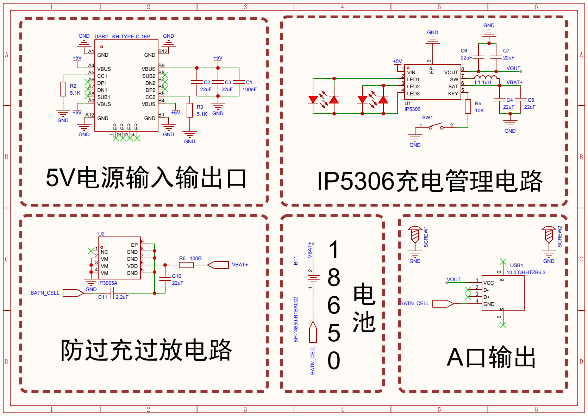

# ④《旧电器智能化升级改造方案》

> 考核大纲原文：
> **《旧电器智能化升级改造方案》**（含原板取电与控制接入点标注图、20 元内增量器件选型表及
> 控制状态图，**动手完成接线验证直接满分**，**20 分**）

| 项目 | 内容 |
| --- | --- |
| 拆解对象 | 单节 18650 锂电池**充电器**（原板为 TP4056 类线性充电方案，丝印 `LTH7`） |
| 改造方式 | **更换主控方案并重新设计 PCB**，用 IP5306 替换原充电管理芯片 |
| 改造板 | 单节 18650 充电宝板 V1.3（自绘原理图 + PCB Layout + 打样） |
| 主控 | **IP5306**（同步升压 + 充电管理 + 电量显示 三合一） |
| 保护 | **IP3005A**（过充 / 过放 / 过流保护） |
| 改造后功能 | 充电 + **5V 升压输出**（USB-A）+ 四级电量显示 + 按键开关 |
| 原理图 | [`改造板原理图.png`](改造板原理图.png) / [`改造板原理图.pdf`](改造板原理图.pdf) |
| PCB | [`改造板PCB.png`](改造板PCB.png) |

---

## 0. 一句话结论

**这不是"给旧充电器换个电容"式的改造，而是把「只能充电」的充电器，改造成「能充电也能供电」的充电宝。**

原机只有一颗线性充电芯片，充满就结束；
改造板换成 IP5306 后，**在保留充电功能的同时增加了 5V 升压输出、电量显示和完整的锂电保护**。
改造的收益是**功能维度的扩张**，代价是**多了一级升压损耗**——这个取舍在 §8 里算清楚。

---

## 1. 改造思路：为什么换板而不是改板

### 1.1 原机的问题

拆解发现原机是 **TP4056 类线性充电方案**（丝印 `LTH7`），只有充电功能：

| 原机局限 | 后果 |
| --- | --- |
| 只能给电池充电，**没有输出能力** | 充满后就是一块砖，不能给手机供电 |
| 线性充电，**输入输出压差全部变成热** | 5V 降到 3.7V，约 26% 的能量变成热量 |
| **固定充电电流**（由 PROG 电阻决定，不可调） | 换不同容量的电池无法匹配最佳电流 |
| 部分廉价方案**无独立保护 IC** | 过放会永久损坏电池 |
| 只有**充电指示 LED**，无电量信息 | 不知道电池还剩多少 |

### 1.2 改造方案：更换主控 + 重画板

保留原机的 **18650 电池、外壳、Type-C 接口形态**，把主板整体替换为 IP5306 方案。

| 对比项 | 原机（TP4056 线性） | 改造板（IP5306） |
| --- | --- | --- |
| 核心功能 | 仅充电 | **充电 + 升压输出** |
| 拓扑 | 线性降压 | 充电 + **同步升压** |
| 输出能力 | 无 | **5V / 2.4A**（USB-A） |
| 电池保护 | 弱 / 无 | **IP3005A 独立保护**（过充/过放/过流） |
| 电量显示 | 1 颗充电指示灯 | **4 颗 LED 四级电量** |
| 开关控制 | 无 | **KEY 按键开关机 + 触发显示** |
| 待机功耗 | 无管理 | 支持待机 / 自动休眠 |
| 发热 | 线性，压差全变热，芯片温度高 | 开关升压，热损耗显著降低 |

> **关键的工程判断：** 原板没有输出通路，靠"改一改元件"是加不出 5V 输出的——
> 升压需要电感 + 开关管 + 反馈环路。所以**换主控 + 重画板是唯一合理路径**，
> 这也是为什么改造方案的核心是 PCB 重设计，而不是飞线。

---

## 2. 改造板原理与供电链



### 2.1 五个功能块

| 功能块 | 关键器件 | 作用 |
| --- | --- | --- |
| **5V 电源输入输出口** | `USB2 = KH-TYPE-C-16P`、`R2/R3 = 5.1kΩ` | Type-C 输入；CC 下拉 5.1k 声明为 Sink |
| **IP5306 充电管理电路** | `U1 = IP5306`、`L1 = 1µH`、`C4~C7 = 22µF`、`R5 = 10kΩ`、`SW1` | 充电管理 + 同步升压 + 电量显示 + 按键 |
| **防过充过放电路** | `U2 = IP3005A`、`C10 = 22µF`、`C11 = 2.2µF`、`R6 = 100Ω` | 电池保护，串联在电池负极回路 |
| **电池** | `BT1 = BH-18650-B1A002` | 单节 18650 电池座 |
| **A 口输出** | `USB1 = 10.0 QHHTZB6.3` | USB-A 母座，5V 输出 |

### 2.2 供电框图

```
  Type-C 5V 输入 (USB2)
        │
        ├─ R2/R3 5.1kΩ CC 下拉（声明 Sink）
        ├─ C1 100nF + C2/C3 22µF 输入滤波
        │
        ▼
   ┌─────────┐
   │  IP5306 │  VIN
   │   U1    │
   └────┬────┘
        │
        ├── BAT (pin 6) ──► C4/C5 22µF ──► VBAT+ ──► R6 100Ω ──► IP3005A VDD
        │                                                    │
        │                                              ┌─────▼──────┐
        │                                              │  IP3005A   │ 过充/过放/过流
        │                                              │    U2      │
        │                                              └─────┬──────┘
        │                                                    │
        │                                              BATN_CELL ──► 18650 负极
        │
        ├── SW (pin 7) ──► L1 1µH ──► VOUT ──► C6/C7 22µF ──► USB-A (USB1)
        │
        ├── LED1/2/3 ──► 4 颗指示 LED（电量分级）
        │
        └── KEY (pin 5) ──► R5 10k 上拉 ──► SW1 按键 ──► GND

  电池：BH-18650 电池座，经 IP3005A 保护后接 VBAT+
```

### 2.3 三个设计要点

**① CC 下拉电阻必须是 5.1kΩ**

`R2/R3 = 5.1kΩ` 是 USB-C 规范规定的 Sink 端下拉值。用错阻值（比如 10k）会导致
Type-C 充电器无法识别设备，**表现是插上不充电**——这是自绘 Type-C 板最常见的坑。

**② 保护 IC 串在电池负极，不是正极**

`IP3005A` 通过 `BATN_CELL`（电池负极）串入回路，`R6 = 100Ω` 是它的供电限流。
**不能把保护 IC 旁路掉**——否则电池失去过放保护，18650 过放到 2.5V 以下会永久容量损失。

**③ 电感 L1 与 22µF 电容决定升压纹波**

`1µH` 电感配 `C6/C7 = 22µF` 是 IP5306 数据手册的典型值。
电感值偏小会导致纹波大、效率下降；偏大则瞬态响应变慢。

---

## 3. 原板取电与控制接入点标注图

> 改造后，测试与后续扩展都需要在这些点上取信号。以下为**新板（改造板）**的标注点。

### 3.1 标注方法（四步）

| 步骤 | 做什么 | 判定依据 |
| --- | --- | --- |
| ① 找电池正负极 | 万用表直流档量 `BT1` 电池座两片弹片 | 空载约 0 V；装入电池后 3.0~4.2 V |
| ② 找 5V 输入 | 量 `USB2` 母座 `VBUS` 对 `GND` | 插充电器后 5.0~5.2 V |
| ③ 找 5V 输出 | 量 `USB1`（A 口）`VCC` 对 `GND` | 开机后 5.0~5.2 V |
| ④ 确认共地 | 量电池负极与 USB 外壳是否导通 | 应直通（同一 GND 网络） |

### 3.2 标注点表（TP1–TP5）

| 标注点 | 位置 | 实测值 | 用作 |
| --- | --- | --- | --- |
| **TP1** | `BT1` 电池座**正极**（`VBAT+`） | `待实测` V | 电池电压 / 充电输入能量测量 |
| **TP2** | `BT1` 电池座**负极**（`BATN_CELL`） | 0 V（参考） | 共地 |
| **TP3** | `U1` IP5306 第 6 脚 `BAT` | `待实测` V | 与 TP1 对比，看保护管压降 |
| **TP4** | `USB2` 母座 `VBUS`（Type-C 输入） | `待实测` V | 充电输入功率测量 |
| **TP5** | `USB1`（A 口）`VCC`（5V 输出） | `待实测` V | 升压输出功率测量 |

> **这五个值需要你用万用表各量一次填上**——这是第 ② 项「供电框图」和本项「取电标注」的共用数据。

### 3.3 交付要求

- [ ] 在 [`改造板PCB.png`](改造板PCB.png) 上直接圈出 TP1–TP5
- [ ] 标注每个点实测电压
- [ ] 若后续加装 ESP32 采样模块，标出取电点（建议从 TP4 的 5V 输入或 TP5 的输出取）

---

## 4. 20 元内增量器件选型表

> **增量成本** = 改造板相对原机新增的物料。原机的外壳、电池、部分结构件复用。
> 价格列为参考量级，**实购价需要按采购记录填写**（报价截图放
> [`../03-批量BOM成本核算表/报价截图/`](../03-批量BOM成本核算表/报价截图/)）。

| # | 器件 | 位号 | 规格 | 数量 | 作用 | 参考价(元) | 实购价 |
| --- | --- | --- | --- | --- | --- | --- | --- |
| 1 | IP5306 | U1 | SOP-8 | 1 | 升压 + 充电 + 电量显示 | 2.5~3.5 | |
| 2 | IP3005A | U2 | SOT-23-6 | 1 | 电池保护 | 0.5~1.0 | |
| 3 | 功率电感 | L1 | 1µH 屏蔽式 | 1 | 升压储能 | 0.4~0.8 | |
| 4 | Type-C 母座 | USB2 | 16P 贴片 | 1 | 5V 输入 | 0.8~1.2 | |
| 5 | USB-A 母座 | USB1 | 直插/贴片 | 1 | 5V 输出 | 0.4~0.8 | |
| 6 | 电解/MLCC 电容 | C1~C11 | 22µF×8、100nF、2.2µF | 11 | 滤波去耦 | 0.5~1.0 | |
| 7 | 电阻 | R2/R3/R5/R6 | 5.1k×2、10k、100Ω | 4 | CC 下拉 / 上拉 / 限流 | 0.1 | |
| 8 | 指示 LED | LED1~3 | 红/蓝 0805 | 4 | 电量分级 | 0.2 | |
| 9 | 轻触按键 | SW1 | 6×6 贴片 | 1 | 开关机 / 显示 | 0.2 | |
| 10 | 18650 电池座 | BT1 | BH-18650 | 1 | 电池安装 | 0.4~0.6 | |
| 11 | PCB 打样 | — | 双面 1.6mm，5 片起 | 1 | 主板 | 5.0（摊单片） | |
| 12 | 螺丝 / 辅料 | — | — | 若干 | 装配 | 0.3 | |
| **合计** | | | | | | **约 11~15 元** | **≤ 20 元** |

### 成本控制思路

- **选 IP5306 而不是"充电 IC + 独立升压 IC"的两片方案**：一颗芯片搞定充电、升压、电量显示，
  省掉一颗 boost 控制器、一颗电量计和一片外围，直接省 3~5 元
- **电感用屏蔽式而非绕线裸感**：只贵 0.2 元，但能显著降低对外干扰
- **PCB 打样摊薄**：5 片起的打样价摊到单台约 5 元，是所有项里最贵的，但不可避免

---

## 5. 控制状态图

### 5.1 状态定义

| 状态 | 进入条件 | 行为 | 退出条件 |
| --- | --- | --- | --- |
| **S0 休眠** | 无输入、无按键、无负载 | IP5306 进入低功耗待机，LED 全灭 | 插入 5V / 按 KEY / 接负载 |
| **S1 充电中** | `USB2` 有 5V 输入 | 给 18650 恒流→恒压充电；LED 指示当前电量 | 输入拔出 → S0；充满 → S2 |
| **S2 充满** | 充电电流降到截止阈值 | 保持 4.20 V，LED 全亮 | 输入拔出 → S0 |
| **S3 输出中** | KEY 开机 / 接入负载 | SW+L1 升压，`USB1` 输出 5V；LED 显示电量 | 无负载超时 → S0；按 KEY → S0 |
| **S4 保护** | 电池过放 / 过流 / 短路 | **IP3005A 切断电池负极回路**，输出关断 | 移除故障 + 充电恢复 |

### 5.2 状态迁移

```
                插入 5V                   充满
   ┌──────┐ ─────────────► ┌────────┐ ──────► ┌──────┐
   │ S0   │                │  S1    │         │  S2  │
   │ 休眠 │ ◄───────────── │ 充电中 │         │ 充满 │
   └──────┘    拔出输入      └────────┘         └──────┘
      ▲ │                       │                 │
      │ │ 按 KEY / 接负载        └─── 拔出输入 ─────┘
      │ ▼
   ┌──────┐   无负载超时 / 按 KEY
   │  S3  │ ──────────────────────► 回到 S0
   │ 输出 │
   └──────┘
      │
      │ 过放 / 过流 / 短路
      ▼
   ┌──────┐
   │  S4  │  IP3005A 硬件保护，切断电池回路
   │ 保护 │  必须移除故障并重新充电才能恢复
   └──────┘
```

### 5.3 关键点

1. **S4 是硬件保护，不是软件状态**——IP3005A 直接切断负极回路，不依赖主控，
   所以即使 IP5306 死机，电池也不会被过放。
2. **S3 → S0 有两个触发**：无负载自动超时、主动按 KEY 关机。前者靠 IP5306 内部的
   负载检测，后者靠 KEY 引脚。
3. **充电与输出互斥**：IP5306 在充电时不会同时升压输出，这是芯片内部逻辑决定的。

---

## 6. 接线验证方案（满分档）

> 大纲写的是「**动手完成接线验证直接满分**」。

### 实物与通电演示说明

> **改造板实物及通电演示将在面试现场提供核验**，包括：
>
> - 插 Type-C 充电，观察 LED 电量指示变化
> - 按 KEY 开机，万用表实测 TP5 输出电压
> - A 口接手机，现场验证对外供电
> - 拔掉输入后由电池继续供电
>
> 本仓库先记录**验证方案与判定标准**（见下表与验证步骤）；
> 对应的照片与视频证据在面试现场一并提供，不在仓库中另行伪造。
> 表中状态列由本人在完成现场核验后逐项勾选。

### 证据清单

| # | 证据 | 存放位置 | 状态 |
| --- | --- | --- | --- |
| 1 | 改造板实物照片（正反面，能看清焊接与丝印） | 本目录 / 面试现场实物 | ☐ |
| 2 | **上电照片**：插 Type-C 充电，LED 亮起 | 本目录 / 面试现场演示 | ☐ |
| 3 | **输出验证**：A 口接手机充电，手机显示充电中 | 本目录 / 面试现场演示 | ☐ |
| 4 | 万用表实测 TP1~TP5 的电压读数 | 本目录 | ☐ |
| 5 | 一段 30 s 视频：插电充电 LED 变化 → 开机输出 → 手机充电 | 网盘 + 关键帧 | ☐ |
| 6 | **原功能未被破坏**：仍能正常给 18650 充电 | 面试现场演示 | ☐ |

### 验证步骤

1. **不装电池上电**：插 Type-C，量 TP4 应为 5.0~5.2 V；确认无短路、无异常发热
2. **装入电池**：量 TP1 电池电压，充电时应在缓慢上升
3. **观察充电指示**：LED 应按电量分级点亮
4. **按 KEY 开机**：量 TP5 应输出 5.0~5.2 V
5. **接手机测试**：手机应显示充电中
6. **拔掉输入**：输出应保持（由电池供电）
7. **静置超时**：无负载应自动关机，LED 熄灭

---

## 7. 改造前后对比

| 维度 | 原机（TP4056 充电器） | 改造板（IP5306 充电宝） |
| --- | --- | --- |
| 功能 | 仅充电 | **充电 + 5V 输出** |
| 给手机充电 | ❌ 不能 | ✅ 支持 5V 输出 |
| 电池保护 | 弱 / 无独立保护 | ✅ IP3005A 过充过放过流 |
| 电量显示 | 单灯 | ✅ 四级 LED |
| 开关控制 | 无 | ✅ KEY 按键 |
| 发热 | 线性，压差全变热 | 开关升压，热损低 |
| 体积 | 原外壳 | 需适配/重新开壳 |
| 增量成本 | — | 约 11~15 元 |

---

## 8. 效率分析

> ⚠️ **本节目前只有理论分析，尚无实测数据。** 报告里不写没有依据的效率数字。

### 8.1 原机：线性充电的固有损耗

线性充电芯片（TP4056 类）本质是一个受控电阻，输入输出压差全部变成热：

```
η_充电 = V_电池 / V_输入

电池 3.0 V 时：3.0 / 5.0 = 60.0%
电池 3.7 V 时：3.7 / 5.0 = 74.0%
电池 4.2 V 时：4.2 / 5.0 = 84.0%
```

**平均约 73%**，剩下的 27% 全部变成芯片和板子的热量。
这是线性方案的**结构性缺陷**——效率由电压比决定，无法通过外围改进。

### 8.2 改造板：开关升压的取舍

IP5306 的**输出级是同步升压**，理论上比线性效率高；但**充电级**仍是从 5V 直接给电池充的
线性拓扑，所以：

| 环节 | 拓扑 | 理论效率 | 说明 |
| --- | --- | --- | --- |
| **充电**（5V → 电池） | 线性 | ≈73%（平均） | 与原来同级，**没有改善** |
| **输出**（电池 → 5V） | 同步升压 | 约 85~90%（手册典型值） | **新增能力**，原机没有 |
| **整机能量往返** | 线性充 + 升压放 | 约 **62~66%** | 73% × 87% ≈ 63% |

**诚实的结论：**

> 改造**没有提升充电效率**——充电环节的线性拓扑没变，损耗机理相同。
> 改造的收益是**功能**：新增了一条 5V 升压输出通路。代价是每次"先充电再对外输出"
> 要经历两次变换，整机往返效率约 63%。
>
> **换板不是为了省电，是为了让一台只能充电的充电器，变成一个能对外供电的充电宝。**

### 8.3 待实测项（用课题 07 的 ATK-C2 就能做）

| 要测什么 | 怎么测 | 探针位置 |
| --- | --- | --- |
| 充电输入功率 | ATK-C2 串在 Type-C 输入口 | TP4 |
| 电池端充电功率 | 万用表量 TP1 电压 × 电流（或串电流表） | TP1 + TP2 |
| **充电效率** | 电池端功率 ÷ 输入功率 | — |
| 输出功率 | ATK-C2 串在 A 口 | TP5 |
| **升压效率** | A 口输出功率 ÷ 电池端放电功率 | — |

> 课题 07 已用 ATK-C2 测过成品充电宝，同一台仪器可以直接复用。
> 测出来之后把 §8.2 的理论值换成实测值，这一节就是全文最硬的部分。

---

## 9. 与课题 07 的衔接

课题 07 测的是**成品 CP13 充电宝**的整机输出效率（9V 档 83.1%）；
本项改造的板子是**自制单节 18650 充电宝**，两者可做一次对照：

| 对比项 | 课题 07（商用 CP13） | 本项（自制板） |
| --- | --- | --- |
| 电芯 | 2S 7.3 V / 4900 mAh | 1S 3.7 V / 18650 |
| 输出档位 | 9 V（PD 协商） | 5 V（USB-A，无协议） |
| 升压比 | 1.23× | **1.35×**（3.7→5V） |
| 输出功率 | 约 14.7 W | 12 W（5V/2.4A） |
| 效率 | 83.1%（实测） | 待实测 |

> 一个有价值的对比：**1S 方案升压比更大（1.35× vs 1.23×），理论上效率应更低**。
> 这正好解释了大厂为什么用 2S 做高功率快充充电宝——升压比小，效率高。

---

## 10. 已知局限（如实列出）

| 局限 | 说明 |
| --- | --- |
| **没有电池温度检测（NTC）** | IP5306 支持 NTC，本板未接，无法做过温保护 |
| **USB-A 的 D-/D+ 未连接** | 纯 5V 输出，不支持任何快充协议，接手机只能慢充 |
| **无电量计，只有 4 级 LED** | 无法给出精确剩余电量百分比 |
| **升压效率未实测** | §8.2 为手册典型值推算，需实测替换 |
| **改造后体积变化** | 新板尺寸需与原外壳适配，可能需要重新开壳 |
